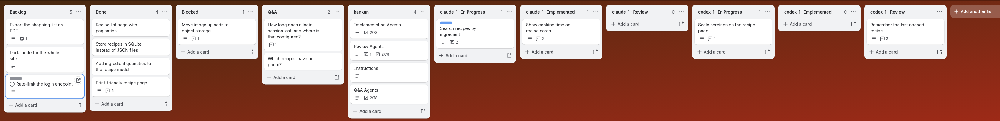
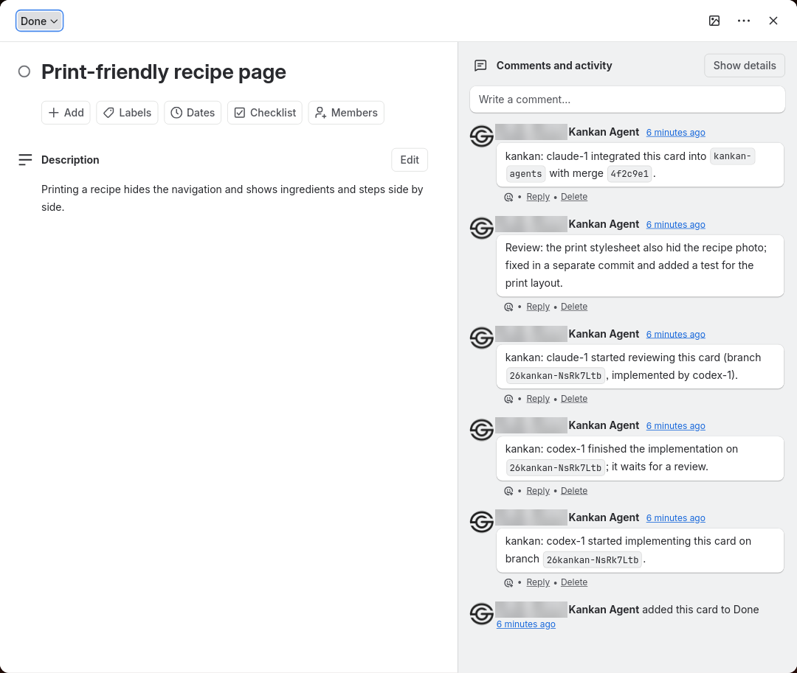
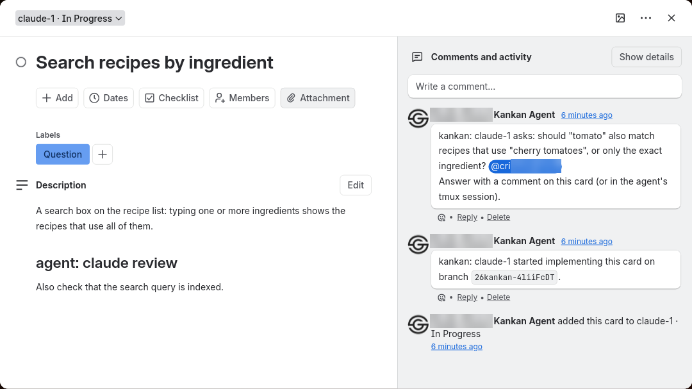
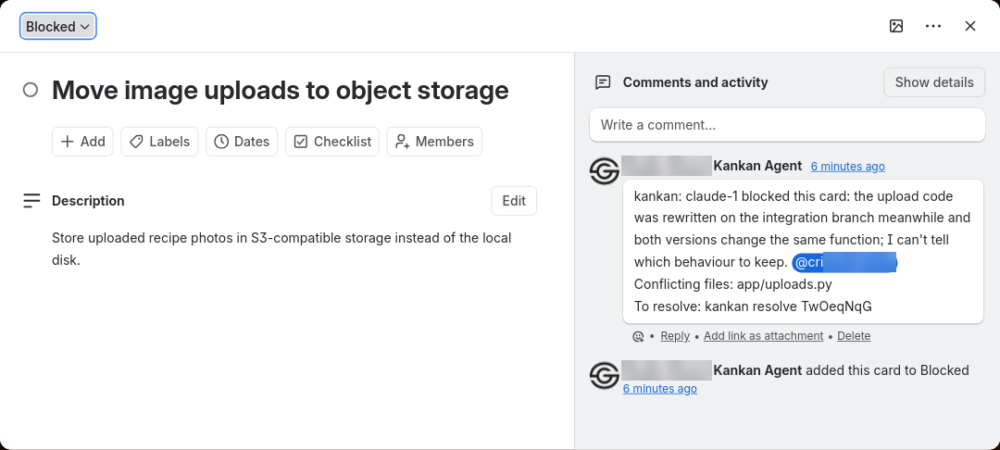
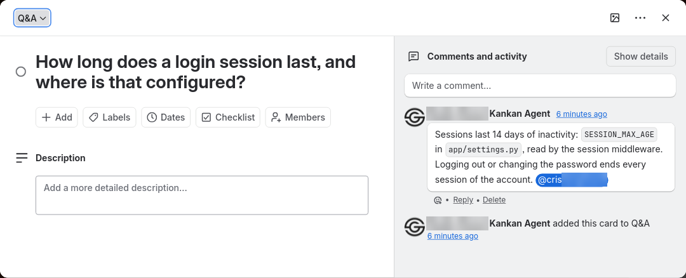

# kankan

kankan turns a Trello board into a team of AI coding agents. You write tasks as cards; several agents (Claude Code and Codex CLI) pick them up in parallel, implement them, review each other's work and deliver the result to your Git repository. You decide what gets done and in which order; the agents do the rest and come to you only when they need a decision.

*A project board while the agents work. Cards wait in `Backlog`, each agent has its own `In Progress`, `Implemented` and `Review` lists, and finished cards end up in `Done`.*

kankan is most useful when you have a development sandbox in a linux server that runs overnight. Your agents may use the API or a subscription, in which case an external "resumer" process should also be running so that work resumes at the usage limit reset time.

## How it works

1. **You write a card.** Its title and description say what you want, like a ticket for a colleague. The order of the `Backlog` is the order of the work.
2. **An agent implements it.** A free agent takes the top card, moves it to its own `In Progress` list, works on a branch of its own and moves the card to `Implemented` when it is finished.
3. **An agent of the other kind reviews it.** A Claude implementation is reviewed by Codex and vice versa. The reviewer fixes what it finds, runs the tests and integrates the card only if they pass.
4. **The card reaches `Done`.** Every step leaves a comment on the card, so its history tells you who did what.

*A finished card tells its own story: codex-1 implemented it, claude-1 reviewed it, fixed a problem and integrated it.*

Two agents never work on the same card, and only reviewed and tested work is delivered. The agents deliver into a branch of their own: your branches are never touched, and you take their work when you choose.

## You stay in charge

- **Agents ask when in doubt.** A card with a `Question` label is waiting for you: you get a Trello notification, and you answer with a comment on the card.

*claude-1 asks a question about a card in progress; replying with a comment sends the answer to the agent, which carries on.*

- **Stop anything with `HOLD`.** Put the `HOLD` label on a card and no agent takes it; if one is already working on it, it saves its work and puts the card back. Removing the label lets the work resume.
- **Problems come back to you.** When an agent cannot safely resolve a conflict, it moves the card to `Blocked` and explains why; `Error` marks a card that needs a look.

*A card the agent could not finish safely: the comment says what went wrong and which files are affected.*

- **Cards can depend on each other.** Attach one card to another and the second waits until the first is done.
- **Add instructions for one kind of agent.** A section such as `agent: claude review` in a card's description reaches only that agent, in that phase.
- **Choose models from the board.** The `kankan` list holds setting cards where you tick the model and effort each kind of agent uses for implementation, review and Q&A.

## Ask questions about your code

Not every card has to be a change. A card in the `Q&A` list is a question: a dedicated agent reads the code and answers with a comment. You can continue the conversation with more comments, and when the discussion turns into a change you want, the agent hands the card over to the normal workflow.

*A question answered from the code, with the exact setting and file to look at.*

## Learn more

- [User manual](docs/user-manual.md): installation, setting up a board, starting the agents and everyday use.
- [Developer manual](docs/developer-manual.md): working on kankan itself.
- [Specification](aispecs/initial_spec_functional.md): the complete description of kankan's behaviour.

## License

Apache License 2.0, see [LICENSE](LICENSE) and [NOTICE](NOTICE).
